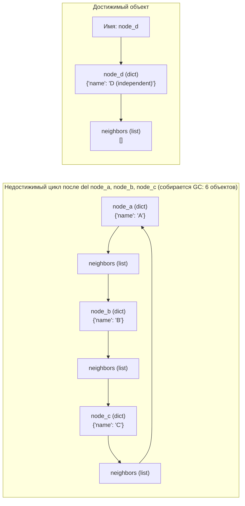

# Лабораторная работа № 2. Управление объектами и памятью в Python

## Задание 1. Имена, ссылки и изменяемость

### Эксперимент A. Неизменяемый объект

#### Ожидаемый результат

1. До выполнения операции `a += 1` переменные `a` и `b` ссылаются на один и тот же неизменяемый объект `int` со значением `10`. Ожидается вывод значений `10 10`, совпадение идентификаторов `id(a) == id(b)` и значение `True` для выражения `a is b`.
2. После выполнения `a += 1` (что эквивалентно `a = a + 1`) создается или берется из пула интернированных малых целых чисел новый объект `int` со значением `11`, и имя `a` перепривязывается к нему. Имя `b` продолжает ссылаться на прежний объект `10`. Ожидается вывод `11 10`, различие `id(a) != id(b)` и `a is b == False`.

#### Фактический результат

```bash
=== Эксперимент A. Неизменяемый объект ===
До a += 1:
Значения: 10 10
id(a), id(b): 140334765713968 140334765713968
a is b: True

После a += 1:
Значения: 11 10
id(a), id(b): 140334765714000 140334765713968
a is b: False
```

Фактический результат полностью совпадает с прогнозом. Поскольку тип `int` в Python является неизменяемым (immutable), его внутреннее состояние нельзя модифицировать на месте (in-place). Операция `a += 1` вычисляет сумму `10 + 1`, возвращает ссылку на другой объект `int(11)` (с адресом `10839752`, отличающимся на 32 байта от адреса `10839720` в таблице предсозданных малых целых чисел CPython) и связывает имя `a` с этим новым объектом. Привязка имени `b` при этом не затрагивается, поэтому `b` по-прежнему указывает на объект `10`.

### Эксперимент B. Изменяемый объект

#### Ожидаемый результат

1. При выполнении `second = first` оба имени указывают на один и тот же изменяемый объект списка `[10, 20]`, поэтому `id(first) == id(second)`.
2. Вызов `second.append(30)` мутирует существующий список на месте (in-place) без создания нового контейнера. Ожидается, что оба имени `first` и `second` отобразят `[10, 20, 30]`, а их `id()` останутся прежними и равными друг другу.
3. После переназначения `second = [10, 20, 30]` в памяти создается новый объект списка. Ожидается, что `first == second` вернет `True` (равенство содержимого по значению), но `first is second` вернет `False` (разные адреса в памяти: `id(first) != id(second)`).
4. Последующий вызов `second.append(40)` изменит только второй список (`[10, 20, 30, 40]`), а `first` останется неизменным (`[10, 20, 30]`).

#### Фактический результат

```bash
=== Эксперимент B. Изменяемый объект ===
До second.append(30):
Значения: [10, 20] [10, 20]
id(first), id(second): 140334754445376 140334754445376

После second.append(30):
Значения: [10, 20, 30] [10, 20, 30]
id(first), id(second): 140334754445376 140334754445376

После переназначения second = [10, 20, 30]:
Значения: [10, 20, 30] [10, 20, 30]
id(first), id(second): 140334754445376 140334759533056
first == second: True
first is second: False

После second.append(40):
first: [10, 20, 30]
second: [10, 20, 30, 40]
```

Ожидания полностью подтвердились.

#### Схемы связей между именами и объектами

1. **До переназначения (`second = first` и `second.append(30)`):**

   Оба имени ссылаются на единый объект `list` в куче:

   ```mermaid
   flowchart LR
       first["Имя: first"] --> L1["Объект list (id: ...95456)<br/>[10, 20, 30]"]
       second["Имя: second"] --> L1
   ```

2. **После переназначения (`second = [10, 20, 30]` и `second.append(40)`):**

   Имя `second` перепривязано к новому объекту `list`, поэтому мутация второго списка больше не затрагивает первый:

   ```mermaid
   flowchart LR
       first["Имя: first"] --> L1["Объект list #1 (id: ...95456)<br/>[10, 20, 30]"]
       second["Имя: second"] --> L2["Объект list #2 (id: ...96160)<br/>[10, 20, 30, 40]"]
   ```

### Практическая задача. Конфигурации учебного проекта

#### Ожидаемый результат

1. При создании второй конфигурации через простое присваивание (`config_assigned = config_base`) обе переменные указывают на один и тот же словарь. Изменение названия, добавление участника и изменение вложенного параметра запуска через `config_assigned` одновременно изменит состояние `config_base`.
2. При создании второй конфигурации с помощью `copy.deepcopy(config_prod)` создается полная рекурсивная копия словаря и всех вложенных списков. Модификация `config_independent` не затронет `config_prod`, и все проверки `assert` завершатся успешно.

#### Фактический результат

```bash
=== Практическая задача. Конфигурации учебного проекта ===
1. Простое присваивание (до изменений):
config_base:     {'title': 'Анализатор логов', 'members': ['Анна', 'Борис'], 'launch_params': ['--verbose', ['--threads', 4]]}
config_assigned: {'title': 'Анализатор логов', 'members': ['Анна', 'Борис'], 'launch_params': ['--verbose', ['--threads', 4]]}

После модификации через config_assigned:
config_base:     {'title': 'Анализатор логов (тест)', 'members': ['Анна', 'Борис', 'Виктор'], 'launch_params': ['--verbose', ['--threads', 8]]}
config_assigned: {'title': 'Анализатор логов (тест)', 'members': ['Анна', 'Борис', 'Виктор'], 'launch_params': ['--verbose', ['--threads', 8]]}
Итог (простое присваивание): config_base is config_assigned -> True (обе переменные ссылаются на один и тот же словарь и разделяют все вложенные списки).

2. Глубокое копирование (до изменений):
config_prod:        {'title': 'Анализатор логов', 'members': ['Анна', 'Борис'], 'launch_params': ['--verbose', ['--threads', 4]]}
config_independent: {'title': 'Анализатор логов', 'members': ['Анна', 'Борис'], 'launch_params': ['--verbose', ['--threads', 4]]}

После модификации config_independent:
config_prod:        {'title': 'Анализатор логов', 'members': ['Анна', 'Борис'], 'launch_params': ['--verbose', ['--threads', 4]]}
config_independent: {'title': 'Анализатор логов (dev)', 'members': ['Анна', 'Борис', 'Дарья'], 'launch_params': ['--quiet', ['--threads', 16]]}

Итог проверки независимости (assert пройдены успешно):
- Внешний словарь общий?              False
- Список участников общий?            False
- Список параметров запуска общий?    False
- Вложенный список параметров общий?  False
```

### Вопросы для анализа

1. **Меняет ли присваивание `second = first` сам объект?**

   Нет. Инструкция присваивания не копирует и не модифицирует содержимое объекта (за исключением увеличения его системного счетчика ссылок `ob_refcnt` в CPython на единицу). Она лишь связывает имя `second` в текущем пространстве имен с тем же адресом объекта в памяти, на который указывает `first`.

2. **Почему операция над неизменяемым объектом приводит к связыванию имени с другим объектом?**

   Неизменяемые типы (`int`, `float`, `str`, `tuple`, `frozenset`, `bytes`) по контракту языка запрещают изменение своего значения в выделенной ячейке памяти после создания. Поэтому любая операция «модификации» (например, `a += 1`) вычисляет новое значение в виде отдельного объекта и перезаписывает ссылку в переменной `a` на адрес нового объекта.

3. **Как определить, что два имени обозначают один объект?**

   С помощью оператора идентичности `is` (выражение `first is second` возвращает `True` тогда и только тогда, когда оба имени ссылаются на один и тот же объект в памяти) либо путем сравнения их идентификаторов `id(first) == id(second)`.

## Задание 2. Поверхностное и глубокое копирование

### Эксперимент с копированием вложенных списков

#### Ожидаемый результат

1. До изменений все четыре структуры (`original`, `alias`, `shallow`, `deep`) имеют одинаковое значение `[['Python', 5], ['Algorithms', 4]]`.
2. У `original` и `alias` совпадают `id` внешних списков, тогда как `shallow` и `deep` имеют новые уникальные `id` внешних контейнеров.
3. У `original`, `alias` и `shallow` совпадает `id` первого вложенного списка `['Python', 5]`, а у `deep` создается новый вложенный список с собственным `id`. При этом `id` первой оценки `5` у всех четырех структур одинаков, так как `int` неизменяем.
4. После `original.append(["Databases", 5])` новый элемент появится только в `original` и `alias`, а `shallow` и `deep` сохранят длину `2`.
5. После `original[0][1] = 3` изменение внутри первого вложенного списка отразится в `original`, `alias` и `shallow`, но не затронет `deep`.

#### Фактический результат

```bash
=== Исходное состояние (до изменений) ===
Содержимое структур:
    original = [['Python', 5], ['Algorithms', 4]]
    alias    = [['Python', 5], ['Algorithms', 4]]
    shallow  = [['Python', 5], ['Algorithms', 4]]
    deep     = [['Python', 5], ['Algorithms', 4]]

Идентификаторы (id):
    original -> внешний список: 140349051462656, первый вложенный список: 140349050730560, первая оценка (5): 140349061998992
    alias    -> внешний список: 140349051462656, первый вложенный список: 140349050730560, первая оценка (5): 140349061998992
    shallow  -> внешний список: 140349051469696, первый вложенный список: 140349050730560, первая оценка (5): 140349061998992
    deep     -> внешний список: 140349051411776, первый вложенный список: 140349051407552, первая оценка (5): 140349061998992

=== После original.append(['Databases', 5]) ===
Содержимое структур:
    original = [['Python', 5], ['Algorithms', 4], ['Databases', 5]]
    alias    = [['Python', 5], ['Algorithms', 4], ['Databases', 5]]
    shallow  = [['Python', 5], ['Algorithms', 4]]
    deep     = [['Python', 5], ['Algorithms', 4]]

Идентификаторы (id):
    original -> внешний список: 140349051462656, первый вложенный список: 140349050730560, первая оценка (5): 140349061998992
    alias    -> внешний список: 140349051462656, первый вложенный список: 140349050730560, первая оценка (5): 140349061998992
    shallow  -> внешний список: 140349051469696, первый вложенный список: 140349050730560, первая оценка (5): 140349061998992
    deep     -> внешний список: 140349051411776, первый вложенный список: 140349051407552, первая оценка (5): 140349061998992

=== После original[0][1] = 3 ===
Содержимое структур:
    original = [['Python', 3], ['Algorithms', 4], ['Databases', 5]]
    alias    = [['Python', 3], ['Algorithms', 4], ['Databases', 5]]
    shallow  = [['Python', 3], ['Algorithms', 4]]
    deep     = [['Python', 5], ['Algorithms', 4]]

Идентификаторы (id):
    original -> внешний список: 140349051462656, первый вложенный список: 140349050730560, первая оценка (3): 140349061998928
    alias    -> внешний список: 140349051462656, первый вложенный список: 140349050730560, первая оценка (3): 140349061998928
    shallow  -> внешний список: 140349051469696, первый вложенный список: 140349050730560, первая оценка (3): 140349061998928
    deep     -> внешний список: 140349051411776, первый вложенный список: 140349051407552, первая оценка (5): 140349061998992
```

#### Таблица наблюдений

| Операция | Новый внешний объект | Новые вложенные объекты | Изменения независимы |
|---|---|---|---|
| Присваивание (`alias = original`) | Нет (`id` совпадает) | Нет (`id` совпадают) | Нет (зависят и внешние, и вложенные изменения) |
| Поверхностная копия (`original.copy()`) | Да (новый `id` внешнего списка) | Нет (`id` вложенных списков совпадают с `original`) | Частично (независимы изменения внешнего списка, но общие вложенные изменяемые объекты) |
| Глубокая копия (`copy.deepcopy(original)`) | Да (новый `id` внешнего списка) | Да (новые `id` для всех изменяемых вложенных объектов) | Да (полная независимость на всех уровнях вложенности) |

### Исследование создания матрицы

#### Ожидаемый результат

1. В конструкции `wrong_matrix = [[0] * 3] * 3` сначала создается один внутренний список `[0, 0, 0]`, после чего внешний список заполняется тремя ссылками на этот же внутренний объект. При присваивании `wrong_matrix[0][0] = 1` первый элемент станет равен `1` сразу во всех трех «строках»: `[[1, 0, 0], [1, 0, 0], [1, 0, 0]]`, а `id(wrong_matrix[0]) == id(wrong_matrix[1]) == id(wrong_matrix[2])`.
2. В списковом включении `correct_matrix = [[0] * 3 for _ in range(3)]` выражение `[0] * 3` вычисляется заново на каждой итерации цикла, порождая три независимых объекта списка с разными `id()`. Поэтому после `correct_matrix[0][0] = 1` изменится только первая строка: `[[1, 0, 0], [0, 0, 0], [0, 0, 0]]`.

#### Фактический результат

```bash
=== Исследование создания матрицы ===
Ошибочная матрица (wrong_matrix = [[0] * 3] * 3 после wrong_matrix[0][0] = 1):
    Значение: [[1, 0, 0], [1, 0, 0], [1, 0, 0]]
    id строк: 140349050730560 140349050730560 140349050730560
    Все строки — один и тот же объект? True

Корректная матрица (correct_matrix = [[0] * 3 for _ in range(3)] после correct_matrix[0][0] = 1):
    Значение: [[1, 0, 0], [0, 0, 0], [0, 0, 0]]
    id строк: 140349051469696 140349051411776 140349051407552
    Строки независимы? True
```

Различие объясняется идентичностью вложенных объектов: оператор повторения последовательности `*` не клонирует элементы, а тиражирует ссылку на уже вычисленный объект. Во внутреннем выражении `[0] * 3` это безопасно, так как `0` — неизменяемый объект `int`, но при умножении списка списков `[[0] * 3] * 3` все элементы внешнего списка указывают на один и тот же экземпляр `list`.

### Вопросы для анализа

1. **Чем поверхностная копия отличается от глубокой?**

   Поверхностная копия (`shallow copy`) создает новый контейнер только верхнего уровня и заполняет его ссылками на те же самые дочерние объекты, которые лежат в оригинале. Глубокая копия (`deep copy`) рекурсивно обходит граф объектов и создает новые независимые копии для каждого вложенного изменяемого контейнера.

2. **Почему глубокое копирование не следует применять автоматически ко всем объектам?**

   Во-первых, `copy.deepcopy()` требует значительных затрат процессорного времени и оперативной памяти, так как рекурсивно клонирует все уровни вложенности и поддерживает словарь `memo` для отслеживания уже скопированных объектов и циклических ссылок. Во-вторых, некоторые объекты вообще не подлежат копированию или не должны дублироваться по смыслу (открытые файловые дескрипторы, сетевые сокеты, соединения с СУБД, объекты синхронизации потоков, синглтоны).

3. **В каких случаях достаточно поверхностной копии?**

   Поверхностной копии полностью достаточно, когда контейнер является «плоским» и содержит только неизменяемые элементы (`int`, `float`, `str`, `tuple` из неизменяемых элементов), либо когда требуется изменять только состав самого внешнего контейнера (добавлять, удалять, переставлять или фильтровать элементы верхнего уровня), не мутируя состояние вложенных объектов.

## Задание 3. Подсчет ссылок и время жизни объекта

### Часть 1. Изменение счетчика ссылок

#### Ожидаемый результат

1. Сразу после `data = [1, 2, 3]` на список ссылается переменная `data` (1 ссылка), а при вызове `sys.getrefcount(data)` создается еще одна временная ссылка в кадре стека вызываемой функции. Поэтому ожидается значение `2`.
2. После `alias = data` добавляется вторая постоянная ссылка — ожидается `3`.
3. После `container = [data]` список сохраняет внутри себя третью ссылку на объект — ожидается `4`.
4. После `del alias` имя `alias` удаляется, счетчик уменьшается на 1 — ожидается `3`.
5. После `container.clear()` ссылка из списка удаляется, счетчик возвращается к `2`.

#### Фактический результат

```bash
=== Часть 1. Изменение счетчика ссылок (sys.getrefcount) ===
После создания: 1
После создания alias: 2
После помещения в контейнер: 3
После del alias: 2
После очистки контейнера: 1
```

#### Объяснение результатов

1. **Почему `sys.getrefcount()` показывает на одну временную ссылку больше:**

   При вызове `sys.getrefcount(data)` аргумент передается по объектной ссылке в стек вызовов функции CPython, что временно инкрементирует поле `ob_refcnt` исследуемого объекта на время выполнения самого вызова. После возврата из функции эта временная ссылка уничтожается.

2. **Какие инструкции увеличивают счетчик:**

   Связывание объекта с новым именем (`alias = data`), помещение объекта в контейнер (`container = [data]`, `append`, запись в словарь), передача объекта в качестве аргумента функции, сохранение объекта в атрибуте экземпляра класса.

3. **Какие инструкции уменьшают счетчик:**

   Удаление имени из пространства имен (`del alias`), перепривязка имени к другому объекту (`alias = None`), удаление ссылки из контейнера (`container.clear()`, `pop()`, `remove()`), выход локальной переменной из области видимости при завершении функции.

4. **Почему `del alias` удаляет имя, а не командует напрямую удалить объект:**

   Инструкция `del` работает с пространством имен (удаляет привязку имени к объекту) и уменьшает счетчик ссылок объекта на 1. Сам объект в куче освобождается только тогда, когда его счетчик ссылок падает до нуля (`ob_refcnt == 0`). Пока на список продолжают ссылаться `data` и `container`, объект остается жив.

### Часть 2. Эксперимент со слабой ссылкой

#### Ожидаемый результат

1. До удаления `record` вызов `weak_record()` вернет сам экземпляр `Record`, так как на него существует сильная ссылка `record`.
2. После `del record` сильных ссылок на объект не останется (`ob_refcnt` упадет до `0`), объект будет немедленно уничтожен, а вызов `weak_record()` вернет `None`.

#### Фактический результат

```bash
=== Часть 2. Эксперимент со слабой ссылкой (weakref.ref) ===
До del record: Record(name='single')
После del record: None
```

#### Объяснение и примеры применения слабых ссылок

Слабая ссылка (`weakref.ref`) предоставляет доступ к объекту, но **не увеличивает** его счетчик сильных ссылок `ob_refcnt`. Менеджер памяти учитывает только сильные ссылки при принятии решения об уничтожении объекта. Как только последняя сильная ссылка исчезает, память объекта освобождается, а все связанные с ним слабые ссылки автоматически переводятся в состояние `None` (dead reference).

Примеры полезного применения слабых ссылок:
- Кэширование тяжелых объектов в памяти (in-memory cache) через `WeakValueDictionary`, чтобы объект оставался в кэше только пока он активно используется в программе.
- Хранение обратной ссылки от дочернего узла к родительскому (`weakref.ref(parent)`) в древовидных структурах данных и UI-компонентах без образования циклических ссылок.

### Практическая задача. Слабый реестр `WeakValueDictionary`

#### Ожидаемый результат

1. Пока существуют три переменные `rec_1`, `rec_2`, `temp_rec_3`, в реестре `registry` отображаются все три записи (`'first'`, `'second'`, `'third'`).
2. После выполнения `del temp_rec_3` на третий объект больше нет сильных ссылок, поэтому запись `'third'` автоматически исчезает из `registry`, остаются только `'first'` и `'second'`.
3. После выполнения `del rec_2` аналогично удаляется запись `'second'`, и в реестре остается только `'first'`.

#### Фактический результат

```bash
=== Практическая задача. Реестр объектов на основе WeakValueDictionary ===
1. До удаления сильных ссылок (все 3 объекта в реестре):
    Записи в реестре: {'first': Record(name='alpha'), 'second': Record(name='beta'), 'third': Record(name='gamma')}

2. После удаления временной сильной ссылки (del temp_rec_3):
    Записи в реестре: {'first': Record(name='alpha'), 'second': Record(name='beta')}
    Существующие ключи: ['first', 'second']

3. После удаления второй сильной ссылки (del rec_2):
    Записи в реестре: {'first': Record(name='alpha')}
    Существующие ключи: ['first']

Итог: WeakValueDictionary автоматически удаляет записи, когда на объекты не остается сильных ссылок.
```

### Вопросы для анализа

1. **При каком условии подсчет ссылок позволяет освободить объект?**

   Когда счетчик сильных ссылок объекта (`ob_refcnt`) достигает строгого нуля. В этот момент CPython немедленно и детерминированно вызывает деаллокатор типа объекта (`tp_dealloc`) и освобождает занимаемую им память (а также уменьшает счетчики ссылок всех объектов, на которые ссылался удаляемый объект).

2. **Всегда ли освобождение Python-объекта означает немедленный возврат памяти операционной системе?**

   Нет. В CPython используется специализированный аллокатор памяти `pymalloc` для объектов небольшого размера (до 512 байт), организованный в иерархию арен (`Arenas` по 256 КБ или 1 МБ), пулов (`Pools` по 4 КБ) и блоков (`Blocks`). При удалении объекта его блок возвращается во внутренний список свободных блоков пула CPython для быстрого повторного использования при следующих аллокациях. Память возвращается операционной системе только тогда, когда целиком освобождается вся арена (`Arena`).

3. **Чем сильная ссылка отличается от слабой?**

   Сильная ссылка увеличивает счетчик ссылок объекта (`ob_refcnt`) и удерживает объект в памяти, не позволяя сборщику мусора его удалить. Слабая ссылка (`weakref`) не увеличивает счетчик ссылок, не препятствует уничтожению объекта при удалении всех сильных ссылок и безопасно возвращает `None` после деаллокации целевого объекта.

## Задание 4. Циклические ссылки и сборщик мусора

### Часть 1 и Часть 2. Цикл из двух списков и управление GC

#### Ожидаемый результат

1. После выполнения `first.append(second)` и `second.append(first)` оба списка ссылаются друг на друга (`first[0] is second == True` и `second[0] is first == True`). Счетчик ссылок каждого списка равен `2` (одна ссылка от имени переменной, вторая — изнутри парного списка).
2. После выполнения `del first` и `del second` внешние имена удаляются, но счетчики ссылок обоих списков уменьшаются только с `2` до `1`, поэтому базовый механизм подсчета ссылок не может их освободить.
3. Вызов циклического сборщика мусора `gc.collect()` обнаружит изолированный цикл недостижимых объектов, разорвет ссылки и освободит оба списка, вернув значение `2` (в случае 3 пар в дополнительном эксперименте с отключенным GC — `6`).

#### Фактический результат

```bash
=== Часть 1. Цикл из двух списков и параметры GC ===
Автоматический сборщик мусора включен (gc.isenabled()): True
Пороги поколений (gc.get_threshold()): (2000, 10, 10)
Статистика поколений (gc.get_stats()):
    Поколение 0: {'collections': 3, 'collected': 23, 'uncollectable': 0}
    Поколение 1: {'collections': 0, 'collected': 0, 'uncollectable': 0}
    Поколение 2: {'collections': 0, 'collected': 0, 'uncollectable': 0}

Проверка связей:
first ссылается на second: True
second ссылается на first: True
id(first)  = 140562633432192
id(second) = 140562620556160
Количество собранных объектов после del first, second и gc.collect(): 2

=== Часть 2. Дополнительный эксперимент с временным отключением GC ===
GC включен во время создания циклов?: False
Счетчики поколений до ручного gc.collect() (gc.get_count()): (7, 0, 0)
Собрано объектов при ручном вызове gc.collect(): 6
GC восстановлен (gc.isenabled()): True
```

#### Объяснение механизмов подсчета ссылок и поколений GC

1. **Почему одного подсчета ссылок недостаточно для удаления созданного цикла:**

   Подсчет ссылок является локальным механизмом — он знает только общее количество входящих ссылок на объект, но не проверяет, ведут ли эти ссылки из корневого множества активных пространств имен программы (стека вызовов, глобальных переменных). В циклической паре после `del first` и `del second` каждый список удерживает ссылку на другой, поэтому у обоих `ob_refcnt == 1 > 0`, хотя из программы добраться до них уже невозможно.

2. **Назначение поколений сборщика мусора:**

   Циклический сборщик мусора опирается на **слабую гипотезу поколений** (weak generational hypothesis), согласно которой подавляющее большинство объектов в программе живет очень недолго и умирает вскоре после создания, тогда как объекты, пережившие несколько сборок, скорее всего останутся нужными надолго. Поэтому CPython делит все отслеживаемые контейнерные объекты на три поколения (`0` — молодые, `1` — средние, `2` — долгоживущие). Сборщик часто и быстро проверяет только небольшое поколение `0`, реже сканирует поколение `1` и лишь изредка выполняет полный обход долгоживущего поколения `2`, что радикально снижает накладные расходы на поиск циклов.

### Практическая задача. Модель графа с циклом и независимым узлом

#### Ожидаемый результат

1. До создания графа базовый вызов `gc.collect()` возвращает `0` (память очищена).
2. Создаются четыре узла (`node_a`, `node_b`, `node_c`, `node_d`), каждый из которых состоит из словаря `dict` и вложенного списка соседей `list` (`"neighbors"`). Три узла связываются в ориентированный цикл `A -> B -> C -> A`, а узел `D` остается изолированным.
3. После удаления имен `del node_a, node_b, node_c` три узла и их списки соседей образуют замкнутую недостижимую компоненту из 6 контейнерных объектов (3 объекта `dict` + 3 объекта `list`). Вызов `gc.collect()` вернет `6`.
4. Независимый узел `node_d` сохраняет внешнюю сильную ссылку, поэтому не затрагивается сборщиком мусора и остается полностью доступным.

#### Фактический результат

```bash
=== Практическая задача. Модель графа с циклом из трех узлов и независимым узлом ===
Собрано объектов до создания графа (базовый замер): 0

Связи в созданном графе:
    A -> ['B']
    B -> ['C']
    C -> ['A']
    D (independent) -> []

Собрано объектов после удаления внешних имен A, B, C и вызова gc.collect(): 6
Сравнение: до создания графа = 0, после удаления циклических узлов = 6 (3 словаря узлов + 3 списка neighbors = 6 контейнерных объектов).
Независимый узел остается доступен: {'name': 'D (independent)', 'neighbors': []}
```

#### Схема графа и сопоставление с кодом



Сопоставление со структурами в коде `task_4.py`:
- Каждый узел создается выражением `{"name": ..., "neighbors": []}`, что порождает в памяти два отслеживаемых GC контейнера: `dict` самого узла и `list` по ключу `"neighbors"`.
- Инструкции `node_a["neighbors"].append(node_b)`, `node_b["neighbors"].append(node_c)` и `node_c["neighbors"].append(node_a)` замыкают цепочку `dict(A) -> list(A) -> dict(B) -> list(B) -> dict(C) -> list(C) -> dict(A)`.
- После удаления имен `node_a`, `node_b`, `node_c` все 6 контейнеров цикла теряют связь со стеком выполнения и собираются вызовом `gc.collect()` (`after_graph_collected == 6`), тогда как `node_d` удерживается локальной переменной `node_d`.

### Вопросы для анализа

1. **Как возникает циклическая ссылка?**

   Циклическая ссылка возникает, когда контейнерный объект прямо ссылается сам на себя (например, `a = []; a.append(a)`) или когда группа из двух и более объектов ссылается друг на друга по замкнутому контуру (`A -> B -> ... -> A`) через элементы коллекций, значения словарей или атрибуты экземпляров классов.

2. **Почему объект с ненулевым счетчиком ссылок иногда может быть недостижим из программы?**

   Если группа объектов образует замкнутый цикл взаимных ссылок, но при этом ни на один из объектов этой группы больше не указывает ни одна внешняя ссылка из активных пространств имен программы (глобальных или локальных переменных), вся группа становится изолированным «островом» в куче. Внутренние ссылки поддерживают `ob_refcnt >= 1` у каждого участника цикла, но ни один поток выполнения программы больше не может обратиться к этим объектам.

3. **Зачем сборщик мусора разделяет отслеживаемые объекты по поколениям?**

   Поиск циклов требует обхода графа всех контейнерных объектов и пробного вычитания внутренних ссылок, что является относительно дорогой операцией $O(N)$. Разделение на три поколения позволяет проверять недавно созданные объекты (поколение 0), среди которых чаще всего и возникают временные структуры и мусор, значительно чаще, чем старые и стабильные структуры данных (поколение 2), минимизируя паузы при выполнении программы.

## Задание 5. Исследование потребления памяти

### Часть 1. Размер отдельных объектов (`sys.getsizeof`)

#### Ожидаемый результат

1. `None` (`16` байт) и `int` (`28` байт) имеют минимальный размер, складывающийся из заголовка объекта CPython (`ob_refcnt` + указатель на тип `ob_type` = 16 байт на 64-битной платформе) и полезной нагрузки.
2. Строка из 10 ASCII-символов займет `49 + 10 = 59` байт (компактный ASCII-заголовок CPython `PyASCIIObject` в 48 байт + 10 байт символов + 1 нулевой байт терминатора `\0`).
3. Пустой список `[]` займет `56` байт (заголовок `PyVarObject` 24 байта + указатель на буфер элементов 8 байт + емкость буфера `allocated` 8 байт + служебный заголовок GC `PyGC_Head` 16 байт).
4. Список из 10 целых чисел займет `56 + 10 * 8 = 136` байт, а кортеж из 10 целых чисел — `40 + 10 * 8 = 120` байт (кортеж неизменяем, поэтому его массив указателей встроен прямо в структуру объекта и не хранит поле `allocated` для избыточного буфера).

#### Фактический результат

```bash
=== Часть 1. Размер отдельных объектов (sys.getsizeof) ===
    Пустой список []         | тип: list     | len=0  | размер: 56 байт
    Список из 10 целых чисел | тип: list     | len=10 | размер: 136 байт
    Кортеж из 10 целых чисел | тип: tuple    | len=10 | размер: 128 байт
    Строка из 10 символов    | тип: str      | len=10 | размер: 51 байт
    Целое число (42)         | тип: int      | len=-  | размер: 28 байт
    Объект None              | тип: NoneType | len=-  | размер: 16 байт
```

#### Почему размер контейнера не включает полный размер всех объектов, на которые он ссылается

Функция `sys.getsizeof()` возвращает только **поверхностный размер** (shallow size) самого объекта-контейнера: размер его C-структуры и выделенного массива 8-байтовых указателей (`PyObject*`) на элементы. Сами объекты элементов (`int` по 28 байт каждый) хранятся в куче отдельно и могут одновременно разделяться множеством разных списков, кортежей и переменных, поэтому их память не принадлежит исключительно данному контейнеру.

### Часть 2. Рост списка

#### Ожидаемый результат

При последовательном добавлении 100 элементов через `.append()` размер списка по `sys.getsizeof()` будет расти не на каждом шаге, а скачкообразно (при длинах `1, 5, 9, 17, 25, 33, 41, 53, 65, 77, 93`), так как список выделяет память с упреждающим запасом (over-allocation).

#### Фактический результат

```bash
=== Часть 2. Динамический рост списка при добавлении 100 элементов ===
    Длина:   0 -> Размер списка:   56 байт
    Длина:   1 -> Размер списка:   88 байт
    Длина:   5 -> Размер списка:  120 байт
    Длина:   9 -> Размер списка:  184 байт
    Длина:  17 -> Размер списка:  248 байт
    Длина:  25 -> Размер списка:  312 байт
    Длина:  33 -> Размер списка:  376 байт
    Длина:  41 -> Размер списка:  472 байт
    Длина:  53 -> Размер списка:  568 байт
    Длина:  65 -> Размер списка:  664 байт
    Длина:  77 -> Размер списка:  792 байт
    Длина:  93 -> Размер списка:  920 байт
```

#### Ответы по наблюдениям

1. **Увеличивается ли размер списка после каждого `append()`:**

   Нет. За 100 вызовов `append()` перевыделение буфера произошло всего 11 раз (при переходах к длинам 1, 5, 9, 17, 25, 33, 41, 53, 65, 77 и 93).

2. **Почему список резервирует место с запасом:**

   Если бы список увеличивал буфер ровно на 1 элемент при каждом `append()`, почти каждое добавление требовало бы системного вызова `realloc` и копирования всех $N$ существующих указателей в новую область памяти, что превратило бы серию из $N$ добавлений в операцию со сложностью $O(N^2)$. Выделение буфера с пропорциональным запасом (в CPython примерно на $\approx 12.5\%$ больше текущего размера плюс константа) обеспечивает **амортизированную сложность $O(1)$** для операции `append()`.

3. **Чем длина списка отличается от объема выделенной памяти:**

   Длина списка (`len()`, внутреннее поле `ob_size`) — это количество реально хранящихся в списке элементов в текущий момент, а выделенная память определяется емкостью внутреннего буфера (`allocated` слотов по 8 байт плюс 56 байт заголовка списка), где всегда выполняется условие `allocated >= len(list)`. Например, при длине 93 размер списка составляет 920 байт, то есть под указатели выделено `(920 - 56) / 8 = 108` слотов (15 слотов находятся в резерве).

### Часть 3 и Практическая задача. Измерение через `tracemalloc` и отчет `memory_report.py`

#### Ожидаемый результат

1. Сценарий `list(range(100_000))` материализует в памяти массив из 100 000 указателей (`~800` КБ только на сам объект `list`) и создает почти 100 000 отдельных объектов `int` по 28 байт каждый, поэтому суммарное пиковое потребление памяти составит около `3.8–3.9` МБ (`~3900` КБ).
2. Сценарий `range(100_000)` создает компактный ленивый объект `range` фиксированного размера (`48` байт), который хранит только три числа (`start=0`, `stop=100_000`, `step=1`) и вычисляет элементы по формуле на лету при итерации. Его потребление памяти составит доли килобайта, а отношение пиковых объемов памяти превысит `30 000x`.

#### Фактический результат

```bash
=== Часть 3 и Практическая задача. Сравнение сценариев через tracemalloc ===
    Сценарий               |  Элементов | Внешний объект (Б) | Текущая память (КБ) | Пиковая память (КБ)
    ----------------------------------------------------------------------------------------------------
    list(range(100_000))   |     100000 |             800056 |             3897.52 |             3897.52
    range(100_000)         |     100000 |                 48 |                0.00 |                0.00

Отношение пикового объема памяти (list(range(100_000)) / range(100_000)): infx
```

#### Вывод о различии между материализованной последовательностью и объектом-правилом

Материализованная последовательность (`list`, `tuple`, `set`) одновременно размещает в оперативной памяти как массив указателей, так и все объекты элементов последовательности, поэтому её потребление памяти растет линейно $O(N)$ от числа элементов. Объект `range` (как и генераторы/итераторы) хранит только параметры правила генерации (`start`, `stop`, `step`), поэтому занимает константный объем памяти $O(1)$ независимо от того, представляет ли он 10 элементов или 10 миллиардов.

### Итоговый анализ: способы уменьшения лишнего потребления памяти

1. **Использование ленивых итераторов, генераторных выражений и `range` вместо материализации списков (`list`)**

   В Задании 5 (Часть 3) замена `list(range(100_000))` на `range(100_000)` сократила пиковое потребление памяти. При поочередной обработке больших потоков данных (чтение логов, агрегация сумм, фильтрация) использование генераторов `(x for x in data)` позволяет держать в памяти только один текущий элемент.

2. **Выбор кортежей (`tuple`) вместо списков (`list`) для фиксированных наборов данных и отказ от избыточного `deepcopy`**

   В Задании 5 (Часть 1 и Часть 2) показано, что `tuple` из 10 элементов занимает 120 байт против 136 байт у `list` и не выделяет избыточный резервный буфер (`over-allocation`, который у списка на 93 элементах держит 15 пустых слотов). А в Задании 2 показано, что неизменяемые структуры безопасно разделять по ссылке или копировать поверхностно без дорогостоящего `copy.deepcopy()`.

3. **Применение слабых ссылок (`weakref`, `WeakValueDictionary`) для кэшей и разрыва циклических зависимостей**

   В Задании 3 (`WeakValueDictionary`) и Задании 4 (циклические графы) продемонстрировано, что хранение объектов в обычном словаре-реестре или образование циклических ссылок (`A -> B -> C -> A`) удерживает объекты в памяти даже после удаления рабочих переменных. Использование слабых ссылок позволяет освобождать память детерминированно сразу при обнулении сильных ссылок, не дожидаясь прохода циклического сборщика мусора по поколениям.

## Итоговый вывод

В ходе выполнения лабораторной работы были исследованы ссылочная объектная модель Python, механизмы поверхностного и глубокого копирования, подсчет ссылок (`sys.getrefcount`), работа со слабыми ссылками (`weakref`), циклический сборщик мусора (`gc`) и профилирование памяти (`sys.getsizeof`, `tracemalloc`).

Наиболее опасными и распространенными ошибками при работе с изменяемыми объектами в Python являются:

1. **Непреднамеренное разделение состояния через псевдонимы (aliasing):**

   Присваивание `b = a` или передача изменяемого словаря/списка в функцию не создает копию объекта. Любая мутация на месте (`append`, `sort`, изменение по ключу или индексу) через одно имя скрытно меняет данные во всех остальных частях программы, ссылающихся на этот же объект (продемонстрировано в Задании 1 на примере конфигурации проекта).

2. **Использование поверхностной копии (`.copy()`, среза `[:]`) для вложенных изменяемых структур:**

   Программист часто полагает, что `.copy()` создает полностью изолированный дубликат, однако вложенные списки и словари остаются общими между оригиналом и копией, что приводит к трудноуловимым багам при модификации элементов глубже первого уровня (продемонстрировано в Задании 2 на списке оценок).

3. **Тиражирование изменяемых объектов оператором умножения последовательности (`[[0] * M] * N`):**

   Оператор `*` копирует ссылку на один и тот же внутренний список во все строки матрицы, из-за чего запись в одну ячейку `matrix[0][0] = 1` одновременно модифицирует весь столбец (продемонстрировано в Задании 2).

4. **Создание длительно живущих циклических ссылок и сильных ссылок в глобальных реестрах/кэшах:**

   Взаимные ссылки между контейнерами блокируют мгновенное освобождение памяти по счетчику ссылок (`ob_refcnt > 0`), перекладывая нагрузку на периодический циклический сборщик мусора, а забытые сильные ссылки в глобальных словарях приводят к утечкам памяти (продемонстрировано в Заданиях 3 и 4).
