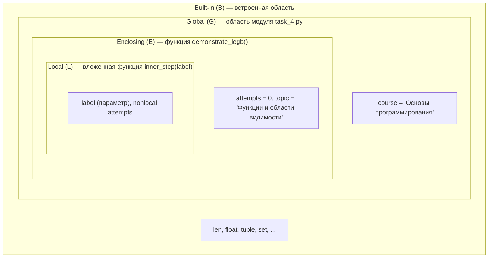

# Лабораторная работа № 3. Алгоритмы, коллекции и функции

## Задание 1. Условия и классификация данных

### Таблица тестовых сценариев

|   № | Входные данные `(score, work_type, absences)` | Ожидаемый результат                                    | Фактический результат                                            | Статус |
| --: | --------------------------------------------- | ------------------------------------------------------ | ---------------------------------------------------------------- | ------ |
|   1 | `(0, 'exam', 0)`                              | уровень `недостаточный`, `экзаменационная работа`      | уровень `недостаточный`, `экзаменационная работа`                | OK     |
|   2 | `(59, 'practice', 2)`                         | уровень `недостаточный`, `практическая работа`         | уровень `недостаточный`, `практическая работа`                   | OK     |
|   3 | `(60, 'project', 1)`                          | уровень `удовлетворительный`, `проектная работа`       | уровень `удовлетворительный`, `проектная работа`                 | OK     |
|   4 | `(74, 'exam', 3)`                             | уровень `удовлетворительный`, `экзаменационная работа` | уровень `удовлетворительный`, `экзаменационная работа`           | OK     |
|   5 | `(75, 'practice', 0)`                         | уровень `хороший`, `практическая работа`               | уровень `хороший`, `практическая работа`                         | OK     |
|   6 | `(89, 'project', 2)`                          | уровень `хороший`, `проектная работа`                  | уровень `хороший`, `проектная работа`                            | OK     |
|   7 | `(90, 'exam', 1)`                             | уровень `отличный`, `экзаменационная работа`           | уровень `отличный`, `экзаменационная работа`                     | OK     |
|   8 | `(100, 'project', 3)`                         | уровень `отличный`, `проектная работа`                 | уровень `отличный`, `проектная работа`                           | OK     |
|   9 | `(95, 'exam', 4)`                             | снижение до `хороший` (`absences > 3`)                 | уровень `хороший`, `экзаменационная работа`                      | OK     |
|  10 | `(50, 'practice', 5)`                         | остается `недостаточный` (не ниже минимума)            | уровень `недостаточный`, `практическая работа`                   | OK     |
|  11 | `(80, 'lab', 1)`                              | уровень `хороший`, `неизвестный тип работы`            | уровень `хороший`, `неизвестный тип работы`                      | OK     |
|  12 | `(105, 'exam', 0)`                            | ошибка диапазона `score`, без классификации            | `Ошибка: результат 105 вне допустимого диапазона 0..100.`        | OK     |
|  13 | `(80, 'exam', 6)`                             | ошибка диапазона `absences`, без классификации         | `Ошибка: количество пропусков 6 вне допустимого диапазона 0..5.` | OK     |

### Порядок проверки условий и достижимость ветвей

1. **Проверка диапазонов выполняется первой:**

   В `classify_student()` сначала проверяется `score < 0 or score > 100`, затем `absences < 0 or absences > 5`. Если хотя бы одно значение некорректно, функция сразу возвращает сообщение об ошибке, и классификация не выполняется.

2. **Проверка порогов уровня идет строго по убыванию (`>= 90`, `>= 75`, `>= 60`, `else`):**

   При таком порядке каждое следующее условие `elif` автоматически отсекает уже проверенные верхние интервалы, поэтому все четыре ветви достижимы. Если бы условия были записаны по возрастанию (например, `if score >= 60` перед `elif score >= 75` и `elif score >= 90`), то ветви `>= 75` и `>= 90` стали бы **недостижимыми**, так как любое число $\ge 75$ уже удовлетворяет условию $\ge 60$.

3. **Снижение уровня при `absences > 3`:**

   Уровень хранится как индекс в кортеже `LEVELS`, и при `absences > 3 and level_index > 0` индекс уменьшается на 1. Условие `level_index > 0` гарантирует, что уровень «недостаточный» (индекс `0`) не снижается дальше.

### Результат работы `task_1.py`

```bash
$ python task_1.py
=== Тестовые сценарии (Части 1–4) ===
 1. (0, 'exam', 0) -> Результат: 0, тип: экзаменационная работа, пропусков: 0 -> уровень: недостаточный
 2. (59, 'practice', 2) -> Результат: 59, тип: практическая работа, пропусков: 2 -> уровень: недостаточный
 3. (60, 'project', 1) -> Результат: 60, тип: проектная работа, пропусков: 1 -> уровень: удовлетворительный
 4. (74, 'exam', 3) -> Результат: 74, тип: экзаменационная работа, пропусков: 3 -> уровень: удовлетворительный
 5. (75, 'practice', 0) -> Результат: 75, тип: практическая работа, пропусков: 0 -> уровень: хороший
 6. (89, 'project', 2) -> Результат: 89, тип: проектная работа, пропусков: 2 -> уровень: хороший
 7. (90, 'exam', 1) -> Результат: 90, тип: экзаменационная работа, пропусков: 1 -> уровень: отличный
 8. (100, 'project', 3) -> Результат: 100, тип: проектная работа, пропусков: 3 -> уровень: отличный
 9. (95, 'exam', 4) -> Результат: 95, тип: экзаменационная работа, пропусков: 4 -> уровень: хороший
10. (50, 'practice', 5) -> Результат: 50, тип: практическая работа, пропусков: 5 -> уровень: недостаточный
11. (80, 'lab', 1) -> Результат: 80, тип: неизвестный тип работы, пропусков: 1 -> уровень: хороший
12. (105, 'exam', 0) -> Ошибка: результат 105 вне допустимого диапазона 0..100.
13. (80, 'exam', 6) -> Ошибка: количество пропусков 6 вне допустимого диапазона 0..5.

=== Практическое расширение (обработка списка записей) ===
Студент  1: Результат: 96, тип: экзаменационная работа, пропусков: 1 -> уровень: отличный
Студент  2: Результат: 91, тип: проектная работа, пропусков: 4 -> уровень: хороший
Студент  3: Результат: 84, тип: практическая работа, пропусков: 2 -> уровень: хороший
Студент  4: Результат: 75, тип: экзаменационная работа, пропусков: 5 -> уровень: удовлетворительный
Студент  5: Результат: 72, тип: проектная работа, пропусков: 0 -> уровень: удовлетворительный
Студент  6: Результат: 60, тип: практическая работа, пропусков: 4 -> уровень: недостаточный
Студент  7: Результат: 58, тип: экзаменационная работа, пропусков: 1 -> уровень: недостаточный
Студент  8: Результат: 100, тип: практическая работа, пропусков: 0 -> уровень: отличный
Студент  9: Результат: 88, тип: неизвестный тип работы, пропусков: 2 -> уровень: хороший
Студент 10: Результат: 45, тип: проектная работа, пропусков: 5 -> уровень: недостаточный

Итоговая сводка по уровням:
    недостаточный: 3
    удовлетворительный: 2
    хороший: 3
    отличный: 2
```

## Задание 2. Циклы и базовые алгоритмические схемы

### Псевдокод ключевых алгоритмов

1. **Проверка простоты числа (`is_prime`):**

   ```text
   АЛГОРИТМ is_prime(n)
       ЕСЛИ n < 2 ТО
           ВЕРНУТЬ False
       divisor <- 2
       ПОКА divisor * divisor <= n ВЫПОЛНЯТЬ
           ЕСЛИ n mod divisor == 0 ТО
               ВЕРНУТЬ False
           divisor <- divisor + 1
       ВЕРНУТЬ True
   ```

2. **Сортировка выбором (`selection_sort`):**

   ```text
   АЛГОРИТМ selection_sort(values)
       result <- копия(values)
       n <- длина(result)
       ДЛЯ i ОТ 0 ДО n - 2 ВЫПОЛНЯТЬ
           min_index <- i
           ДЛЯ j ОТ i + 1 ДО n - 1 ВЫПОЛНЯТЬ
               ЕСЛИ result[j] < result[min_index] ТО
                   min_index <- j
           ЕСЛИ min_index != i ТО
               ОБМЕНЯТЬ result[i] И result[min_index]
       ВЕРНУТЬ result
   ```

3. **Бинарный поиск (`binary_search`):**

   ```text
   АЛГОРИТМ binary_search(sorted_values, target)
       left <- 0
       right <- длина(sorted_values) - 1
       ПОКА left <= right ВЫПОЛНЯТЬ
           middle <- (left + right) // 2
           ЕСЛИ sorted_values[middle] == target ТО
               ВЕРНУТЬ middle
           ЕСЛИ sorted_values[middle] < target ТО
               left <- middle + 1
           ИНАЧЕ
               right <- middle - 1
       ВЕРНУТЬ -1
   ```

### Оценка временной и пространственной сложности

| Алгоритм               | Временная сложность                      | Дополнительная память                                   | Параметр, от которого зависит число операций        |
| ---------------------- | ---------------------------------------- | ------------------------------------------------------- | --------------------------------------------------- |
| `analyze_measurements` | `O(n)`                                   | `O(1)`                                                  | Длина списка `n` (два линейных прохода: `2n` шагов) |
| `linear_search`        | `O(n)` (худший/средний), `O(1)` (лучший) | `O(1)`                                                  | Длина списка `n`                                    |
| `is_prime`             | `O(sqrt(N))`                             | `O(1)`                                                  | Числовое значение входного аргумента `N`            |
| `selection_sort`       | `O(n^2)`                                 | `O(n)` на копию списка (`O(1)` для сортировки на месте) | Длина списка `n` (`n * (n - 1) / 2` сравнений)      |
| `binary_search`        | `O(log n)`                               | `O(1)`                                                  | Длина отсортированного списка `n`                   |

### Почему ограничение делителей квадратным корнем корректно

Если составное число $N$ представляется в виде произведения $N = a \cdot b$ (где $1 < a \le b < N$), то оба множителя не могут одновременно быть строго больше $\sqrt{N}$, иначе выполнялось бы $a \cdot b > \sqrt{N} \cdot \sqrt{N} = N$. Следовательно, меньший делитель $a$ обязательно удовлетворяет условию $a \le \sqrt{N}$. Если ни одно целое число от $2$ до $\lfloor \sqrt{N} \rfloor$ не делит $N$ нацело, то у $N$ нет нетривиальных делителей вообще, и число является простым.

### Сравнительная таблица линейного и бинарного поиска

| Размер `n` | Сценарий     | Цель | Линейный поиск (сравнений) | Бинарный поиск (сравнений) |
| ---------: | ------------ | ---: | -------------------------: | -------------------------: |
|         10 | начало (`1`) |    1 |                          1 |                          5 |
|         10 | середина     |    5 |                          5 |                          1 |
|         10 | конец        |   10 |                         10 |                          7 |
|         10 | отсутствует  |   11 |                         10 |                          8 |
|        100 | начало (`1`) |    1 |                          1 |                         11 |
|        100 | середина     |   50 |                         50 |                          1 |
|        100 | конец        |  100 |                        100 |                         13 |
|        100 | отсутствует  |  101 |                        100 |                         14 |
|       1000 | начало (`1`) |    1 |                          1 |                         17 |
|       1000 | середина     |  500 |                        500 |                          1 |
|       1000 | конец        | 1000 |                       1000 |                         19 |
|       1000 | отсутствует  | 1001 |                       1000 |                         20 |

При росте размера списка в 100 раз (с 10 до 1000) число сравнений линейного поиска в худшем случае выросло ровно в 100 раз (с 10 до 1000), тогда как у бинарного поиска — всего с 8 до 20 (логарифмический рост).

### Результат работы `task_2.py`

```bash
$ python task_2.py
=== Базовые алгоритмические схемы ===
Исходные данные: [12, 15, 11, 18, 18, 9, 21, 15, 7, 18]
Сумма: 144
Среднее арифметическое: 14.40
Минимум: 7
Максимум: 21
Четных значений: 4
Значений больше среднего: 6

=== Линейный поиск ===
Введите целое число для поиска в measurements (Enter для 15): Поиск 15: индекс = 1 (сравнений: 2)
Поиск отсутствующего числа 99: индекс = -1

=== Проверка простоты числа ===
      1 -> не простое
      2 -> простое
      3 -> простое
      4 -> не простое
     17 -> простое
     25 -> не простое
     29 -> простое
     97 -> простое
    100 -> не простое

=== Практическое расширение: сортировка выбором и сравнение поисков ===
Отсортированный список measurements: [7, 9, 11, 12, 15, 15, 18, 18, 18, 21]

  Размер | Сценарий           |   Цель | Линейный (сравн.) | Бинарный (сравн.)
------------------------------------------------------------------------------
      10 | начало (1)         |      1 |                 1 |                 5
      10 | середина           |      5 |                 5 |                 1
      10 | конец              |     10 |                10 |                 7
      10 | отсутствует        |     11 |                10 |                 8
     100 | начало (1)         |      1 |                 1 |                11
     100 | середина           |     50 |                50 |                 1
     100 | конец              |    100 |               100 |                13
     100 | отсутствует        |    101 |               100 |                14
    1000 | начало (1)         |      1 |                 1 |                17
    1000 | середина           |    500 |               500 |                 1
    1000 | конец              |   1000 |              1000 |                19
    1000 | отсутствует        |   1001 |              1000 |                20
```

## Задание 3. Коллекции и выбор структуры данных

### Обоснование выбора коллекций

1. **Почему множество (`set`) подходит для хранения уникальных значений:**

   Множество реализовано на основе хеш-таблицы и автоматически отбрасывает дубликаты при добавлении элемента (`add`). Кроме того, оно поддерживает нативные теоретико-множественные операции (например, пересечение `&` для поиска студентов, сдавших обе работы).

2. **Почему кортеж (`tuple`) можно использовать как ключ словаря:**

   Кортеж из неизменяемых элементов (`(student, laboratory)`, оба типа `str`) сам является неизменяемым и хешируемым объектом (`hash()` вычисляется однозначно и не меняется на протяжении времени жизни ключа).

3. **Почему список (`list`) нельзя использовать как ключ словаря:**

   Список является изменяемым объектом, поэтому в Python для него не определен метод `__hash__` (`TypeError: unhashable type: 'list'`). Если бы список допускался в качестве ключа, его изменение после вставки сломало бы соответствие между хешем и позицией ключа в хеш-таблице словаря.

4. **Почему словарь (`dict`) предпочтительнее списка для частого поиска по составному ключу:**

   Поиск в списке кортежей требует последовательного перебора всех записей за время `O(n)`. Словарь с составным ключом `(student, laboratory)` вычисляет хеш ключа и находит значение в среднем за константное время `O(1)`.

### Средняя сложность операций для использованных коллекций

| Коллекция | Добавление элемента               | Поиск элемента / по ключу | Примечание                                                       |
| --------- | --------------------------------- | ------------------------- | ---------------------------------------------------------------- |
| `set`     | `O(1)` в среднем                  | `O(1)` в среднем          | Хеш-таблица; худший случай `O(n)` при коллизиях                  |
| `dict`    | `O(1)` в среднем                  | `O(1)` в среднем          | Хеш-таблица; инкрементальное обновление без перестроения         |
| `list`    | `O(1)` амортизированно (`append`) | `O(n)` (линейный поиск)   | Используется для хранения упорядоченной истории попыток студента |

### Результат работы `task_3.py`

```bash
$ python task_3.py
=== Исходные коллекции ===
1. Все студенты: ['anna', 'boris', 'daria']
2. Все лабораторные работы: ['lab_01', 'lab_02']
3. Попытки по студентам: {'anna': [('lab_01', 5), ('lab_02', 5), ('lab_01', 4)], 'boris': [('lab_01', 4), ('lab_02', 5)], 'daria': [('lab_01', 3)]}
4. Лучшие результаты: {('anna', 'lab_01'): 5, ('boris', 'lab_01'): 4, ('anna', 'lab_02'): 5, ('daria', 'lab_01'): 3, ('boris', 'lab_02'): 5}
5. Количество попыток: {('anna', 'lab_01'): 2, ('boris', 'lab_01'): 1, ('anna', 'lab_02'): 1, ('daria', 'lab_01'): 1, ('boris', 'lab_02'): 1}
Студенты, сдавшие обе работы (пересечение множеств): ['anna', 'boris']

=== Инкрементальное обновление (добавление новой записи) ===
Добавлена запись: ('daria', 'lab_02', 4)
Обновленные попытки daria: [('lab_01', 3), ('lab_02', 4)]
Обновленный лучший результат (daria, lab_02): 4
Сдали обе работы после обновления: ['anna', 'boris', 'daria']

=== Практическое расширение: текстовые запросы ===
    > student anna
      Попытки студента anna: [('lab_01', 5), ('lab_02', 5), ('lab_01', 4)]
    > best anna lab_01
      Лучший результат для (anna, lab_01): 5
    > attempts boris lab_02
      Количество попыток для (boris, lab_02): 1
    > completed lab_01
      Сдали lab_01: ['anna', 'boris', 'daria']
    > student ivan
      Студент 'ivan' не найден.
    > best daria lab_03
      Нет данных о лучшем результате для (daria, lab_03).
    > unknown command
      Неизвестная команда или неверное число аргументов: 'unknown command'
```

## Задание 4. Функции, параметры и области видимости

### Схема областей видимости LEGB



Порядок поиска каждого использованного имени внутри `inner_step(label)`:

1. `label` — находится сразу в **Local (L)** (параметр функции `inner_step`).
2. `attempts` — объявлено через `nonlocal attempts`, поэтому поиск и модификация (`attempts += 1`) выполняются в **Enclosing (E)** (область функции `demonstrate_legb`).
3. `topic` — отсутствует в Local, находится в **Enclosing (E)**.
4. `course` — отсутствует в Local и Enclosing, находится в **Global (G)** (читается без изменения).
5. `len` — отсутствует в Local, Enclosing и Global, находится в **Built-in (B)**.

### Ошибка изменяемого значения по умолчанию

В определении `def add_result(value, results=[])` объект пустого списка `[]` создается **один раз в момент выполнения инструкции `def`** (при определении функции), а не при каждом её вызове. Ссылка на этот единственный объект сохраняется в атрибуте функции `__defaults__`. При каждом вызове без аргумента `results` метод `results.append(value)` изменяет один и тот же список, накапливая значения между вызовами (`[5, 4]`).

Исправление состоит в использовании неизменяемого маркера `None` по умолчанию (`results: list[int] | None = None`) и создании нового списка внутри тела функции: `if results is None: results = []`.

### Замыкание в `make_threshold_checker(threshold)`

При каждом вызове `make_threshold_checker(threshold)` создается новая внутренняя функция `check(score)`, которая сохраняет в своем замыкании (`__closure__`) ссылку на значение параметра `threshold` из объемлющего кадра вызова. Поэтому `is_pass = make_threshold_checker(60)` хранит `threshold = 60`, а `is_excellent = make_threshold_checker(90)` независимо хранит `threshold = 90`.

### Результат работы `task_4.py`

```bash
$ python task_4.py
=== Проверки основных функций (assert) ===
1. Результат (Анна Иванова): средний балл = 85.00
2. Итог (Борис): средний балл = 72.5
3. Сводка (Дарья): нет результатов
4. Теги: ('python', 'algorithms')

=== Демонстрация распаковки * и ** ===
Распаковка списка (*raw_tags): ('lab_03', 'python')
Распаковка (*report_args, **report_kwargs): Отчет (Илья Смирнов): средний балл = 91.7

=== Исследование LEGB ===
Шаг 1 (проверка): курс='Основы программирования' (длина=23), тема='Функции и области видимости'
Шаг 2 (повтор): курс='Основы программирования' (длина=23), тема='Функции и области видимости'
Глобальное имя course не изменено: Основы программирования

=== Ошибка изменяемого значения по умолчанию ===
Ошибочная функция (общий список): [5, 4] [5, 4]
Исправленная функция (независимые списки): [5] [4]

=== Практическое расширение: функции высшего порядка и замыкания ===
С именованной функцией add_bonus: [70, 85, 100]
С lambda (умножение на 2): [130, 160, 194]
Порог 60 -> 59: False | 60: True
Порог 90 -> 89: False | 90: True
```

## Задание 5. Анализатор учебных результатов

### Правило обработки студента без результатов

Если список оценок студента пуст (`[]`), функции `mean`, `minimum` и `maximum` возвращают `None`, функция `classify(None)` возвращает категорию `"нет данных"`, студент не участвует в расчете общего среднего балла группы и определении лидеров, а в рейтинге помещается в конец списка с пометкой `нет данных`.

### Контракты публичных функций

| Функция                                   | Допустимые входные данные                  | Возвращаемый результат                        | Особые случаи                                                                     |
| ----------------------------------------- | ------------------------------------------ | --------------------------------------------- | --------------------------------------------------------------------------------- |
| `mean(values)`                            | `list[int]`                                | `float \| None` — среднее арифметическое      | Пустой список -> `None`                                                           |
| `minimum(values)`                         | `list[int]`                                | `int \| None` — минимальный элемент           | Пустой список -> `None`                                                           |
| `maximum(values)`                         | `list[int]`                                | `int \| None` — максимальный элемент          | Пустой список -> `None`                                                           |
| `classify(score)`                         | `float \| None`                            | `str` — одна из 5 категорий                   | `None` -> `"нет данных"`                                                          |
| `student_summary(name, results)`          | `str`, `list[int]`                         | `dict[str, object]` со статистикой студента   | Пустой `results` -> `mean/min/max = None`, `category = "нет данных"`              |
| `find_top_students(students)`             | `dict[str, list[int]]`                     | `list[str]` — имена лидеров                   | Пустая группа или нет оценок -> `[]`; равенство -> несколько имен                 |
| `build_ranking(student_data)`             | `list[dict[str, object]]`                  | `list[tuple[str, float \| None]]` по убыванию | Студенты с `mean = None` помещаются в конец                                       |
| `group_summary(students)`                 | `dict[str, list[int]]`                     | `dict[str, object]` со сводкой группы         | Не изменяет `students`; пустая группа -> `group_mean = None`, `top_students = []` |
| `format_report(student_data, group_data)` | Выходы `student_summary` и `group_summary` | `str` — готовый текстовый отчет               | Корректно форматирует пустую группу и `None`                                      |

### Проверка сценариев

|   № | Сценарий                | Проверяемое поведение                                                         | Статус |
| --: | ----------------------- | ----------------------------------------------------------------------------- | ------ |
|   1 | Обычный набор данных    | Статистика 4 студентов, лидер `Дарья`, исходный словарь не изменен            | OK     |
|   2 | Один студент            | Единственный студент (`Елена`) является лидером, `group_mean == 85.0`         | OK     |
|   3 | Несколько лидеров       | `Анна` и `Борис` со средним `90.0` оба попадают в `top_students`              | OK     |
|   4 | Пустая группа           | `student_count == 0`, `group_mean is None`, `top_students == []`, без ошибок  | OK     |
|   5 | Студент без результатов | `Олег` получает категорию `нет данных` и последнее место в рейтинге           | OK     |
|   6 | Граничные значения      | Точное попадание `0, 59, 60, 74, 75, 89, 90, 100` в соответствующие категории | OK     |

### Декомпозиция и сложность построения общей статистики

Программа разделена на три независимых уровня:

1. **Базовые вычисления (`mean`, `minimum`, `maximum`, `classify`):**

   Изолируют элементарные алгоритмы и пороговые правила. Изменение шкалы оценок затрагивает только `classify`.

2. **Агрегация данных (`student_summary`, `find_top_students`, `build_ranking`, `group_summary`):**

   Объединяют базовые функции в сводки по студенту и по группе, не смешивая расчеты с выводом в консоль.

3. **Представление (`format_report`):**

   Отвечает исключительно за текстовое форматирование готовых структур данных.

**Оценка сложности `group_summary(students)`:** пусть в группе $S$ студентов, а суммарное число всех оценок равно $M$. Расчет сводок всех студентов (`student_summary`) и поиск лидеров (`find_top_students`) проходят по всем оценкам за время $O(S + M)$. Построение рейтинга сортировкой выбором (`build_ranking`) выполняется за $O(S^2)$. Итоговая временная сложность составляет $O(M + S^2)$, дополнительная память — $O(S)$ для хранения сводок, счетчиков категорий и списка рейтинга.

### Результат работы `task_5.py`

```bash
$ python task_5.py
=== Сценарий 1. Обычный набор данных ===
--- Статистика по студентам ---
    Анна: средний = 85.25, мин = 78, макс = 91, категория = хороший
    Борис: средний = 66.67, мин = 60, макс = 72, категория = удовлетворительный
    Дарья: средний = 93.75, мин = 90, макс = 97, категория = отличный
    Илья: средний = 58.00, мин = 55, макс = 61, категория = недостаточный
--- Общая статистика группы ---
    Всего студентов: 4
    Общий средний результат группы: 75.92
    Лидер(ы): Дарья
    Распределение по категориям:
        отличный: 1
        хороший: 1
        удовлетворительный: 1
        недостаточный: 1
        нет данных: 0
    Рейтинг:
        1. Дарья (93.75)
        2. Анна (85.25)
        3. Борис (66.67)
        4. Илья (58.00)

=== Сценарий 2. Один студент ===
--- Статистика по студентам ---
    Елена: средний = 85.00, мин = 80, макс = 90, категория = хороший
--- Общая статистика группы ---
    Всего студентов: 1
    Общий средний результат группы: 85.00
    Лидер(ы): Елена
    Распределение по категориям:
        отличный: 0
        хороший: 1
        удовлетворительный: 0
        недостаточный: 0
        нет данных: 0
    Рейтинг:
        1. Елена (85.00)

=== Сценарий 3. Несколько лидеров ===
--- Статистика по студентам ---
    Анна: средний = 90.00, мин = 90, макс = 90, категория = отличный
    Борис: средний = 90.00, мин = 85, макс = 95, категория = отличный
    Виктор: средний = 75.00, мин = 70, макс = 80, категория = хороший
--- Общая статистика группы ---
    Всего студентов: 3
    Общий средний результат группы: 85.00
    Лидер(ы): Анна, Борис
    Распределение по категориям:
        отличный: 2
        хороший: 1
        удовлетворительный: 0
        недостаточный: 0
        нет данных: 0
    Рейтинг:
        1. Анна (90.00)
        2. Борис (90.00)
        3. Виктор (75.00)

=== Сценарий 4. Пустая группа ===
--- Статистика по студентам ---
Нет студентов в группе.
--- Общая статистика группы ---
    Всего студентов: 0
    Общий средний результат группы: нет данных
    Лидер(ы): нет данных
    Распределение по категориям:
        отличный: 0
        хороший: 0
        удовлетворительный: 0
        недостаточный: 0
        нет данных: 0
    Рейтинг:
        нет данных

=== Сценарий 5. Студент без результатов ===
--- Статистика по студентам ---
    Анна: средний = 85.00, мин = 80, макс = 90, категория = хороший
    Олег: нет результатов (категория: нет данных)
--- Общая статистика группы ---
    Всего студентов: 2
    Общий средний результат группы: 85.00
    Лидер(ы): Анна
    Распределение по категориям:
        отличный: 0
        хороший: 1
        удовлетворительный: 0
        недостаточный: 0
        нет данных: 1
    Рейтинг:
        1. Анна (85.00)
        2. Олег (нет данных)

=== Сценарий 6. Граничные значения категорий ===
--- Статистика по студентам ---
    Студент_0: средний = 0.00, мин = 0, макс = 0, категория = недостаточный
    Студент_59: средний = 59.00, мин = 59, макс = 59, категория = недостаточный
    Студент_60: средний = 60.00, мин = 60, макс = 60, категория = удовлетворительный
    Студент_74: средний = 74.00, мин = 74, макс = 74, категория = удовлетворительный
    Студент_75: средний = 75.00, мин = 75, макс = 75, категория = хороший
    Студент_89: средний = 89.00, мин = 89, макс = 89, категория = хороший
    Студент_90: средний = 90.00, мин = 90, макс = 90, категория = отличный
    Студент_100: средний = 100.00, мин = 100, макс = 100, категория = отличный
--- Общая статистика группы ---
    Всего студентов: 8
    Общий средний результат группы: 68.38
    Лидер(ы): Студент_100
    Распределение по категориям:
        отличный: 2
        хороший: 2
        удовлетворительный: 2
        недостаточный: 2
        нет данных: 0
    Рейтинг:
        1. Студент_100 (100.00)
        2. Студент_90 (90.00)
        3. Студент_89 (89.00)
        4. Студент_75 (75.00)
        5. Студент_74 (74.00)
        6. Студент_60 (60.00)
        7. Студент_59 (59.00)
        8. Студент_0 (0.00)
```

## Итоговый вывод

Декомпозиция задач на небольшие функции с четкими контрактами, аннотациями типов и единой ответственностью заметно повысила читаемость и надежность кода. Каждую функцию (например, `mean`, `classify`, `find_top_students`) можно понимать, проверять через `assert` и переиспользовать отдельно от остальных частей программы. Отделение вычислений от форматирования текста (`format_report`) и отказ от мутации входных коллекций упростили тестирование граничных и особых случаев без побочных эффектов.
